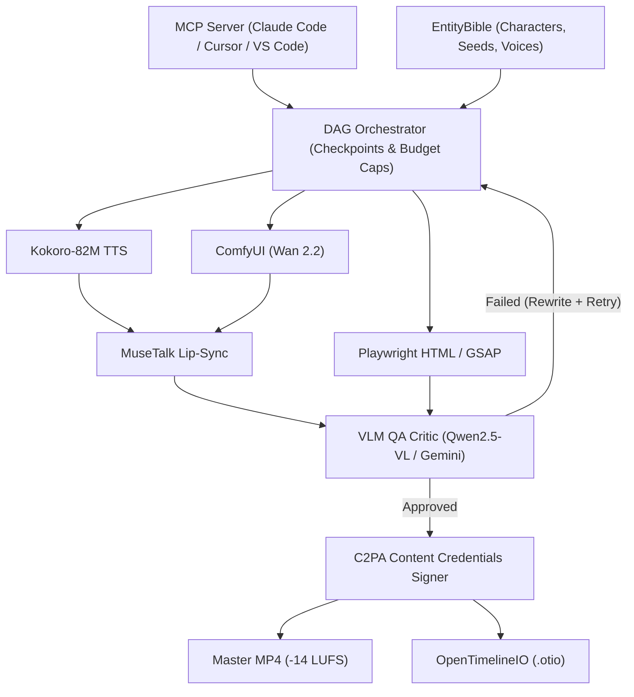

# 🎬 CineForge-Agent

[](https://github.com/Duttaak555/cineforge-agent/actions/workflows/ci.yml)
[](LICENSE)
[](#quick-start)

**A Schema-First, Self-Healing Multi-Agent AI Video Production Studio with MCP, C2PA Provenance & NLE Export.**

CineForge unifies agentic studio orchestration, long-form character/scene continuity, and deterministic HTML/GSAP motion graphics while closing the critical gaps in open-source AI video generators:

* **🔒 Persistent `EntityBible`:** Locks character appearance tokens, seeds, environment lighting LUTs, and voice IDs across every shot and episode.
* **🔁 VLM Self-Healing Critique Loop:** Extracts frames from rendered clips, audits anatomy and prompt fidelity via local Ollama (`qwen2.5vl`) or Gemini Flash, and auto-rewrites failed prompts within a hard `$` budget cap.
* **🗣️ Phoneme Lip-Sync & Hybrid Motion Graphics:** Routes talking-head dialogue through MuseTalk/LivePortrait while rendering kinetic typography and charts via headless Playwright + GSAP.
* **🎞️ Native NLE Export (`.otio`) & C2PA Provenance:** Outputs `-14 LUFS` normalized Master `.mp4` files signed with **C2PA Content Credentials** alongside **OpenTimelineIO (`.otio`)** timelines for DaVinci Resolve and Premiere Pro.
* **🔌 Built-in MCP Server:** Drive the entire studio directly from Claude Code, Cursor, or VS Code Copilot.

## 🏗️ System Architecture



## 🚀 Quick Start

```bash
git clone [https://github.com/Duttaak555/cineforge-agent.git](https://github.com/Duttaak555/cineforge-agent.git)
cd cineforge-agent
uv venv --python 3.12 && source .venv/bin/activate
uv pip install -e ".[dev]"
playwright install chromium
pytest -v
python examples/run_demo.py
```

## 🔌 MCP Configuration (Claude Desktop / Cursor / VS Code)

```json
{
  "mcpServers": {
    "cineforge": {
      "command": "cineforge-mcp",
      "env": {
        "MODE": "production",
        "COMFYUI_URL": "http://localhost:8188",
        "KOKORO_URL": "http://localhost:8880/v1",
        "OLLAMA_URL": "http://localhost:11434"
      }
    }
  }
}
```

## 📄 License

Apache 2.0 — Copyright 2026 Akashdeep Dutta (`Duttaak555`)
