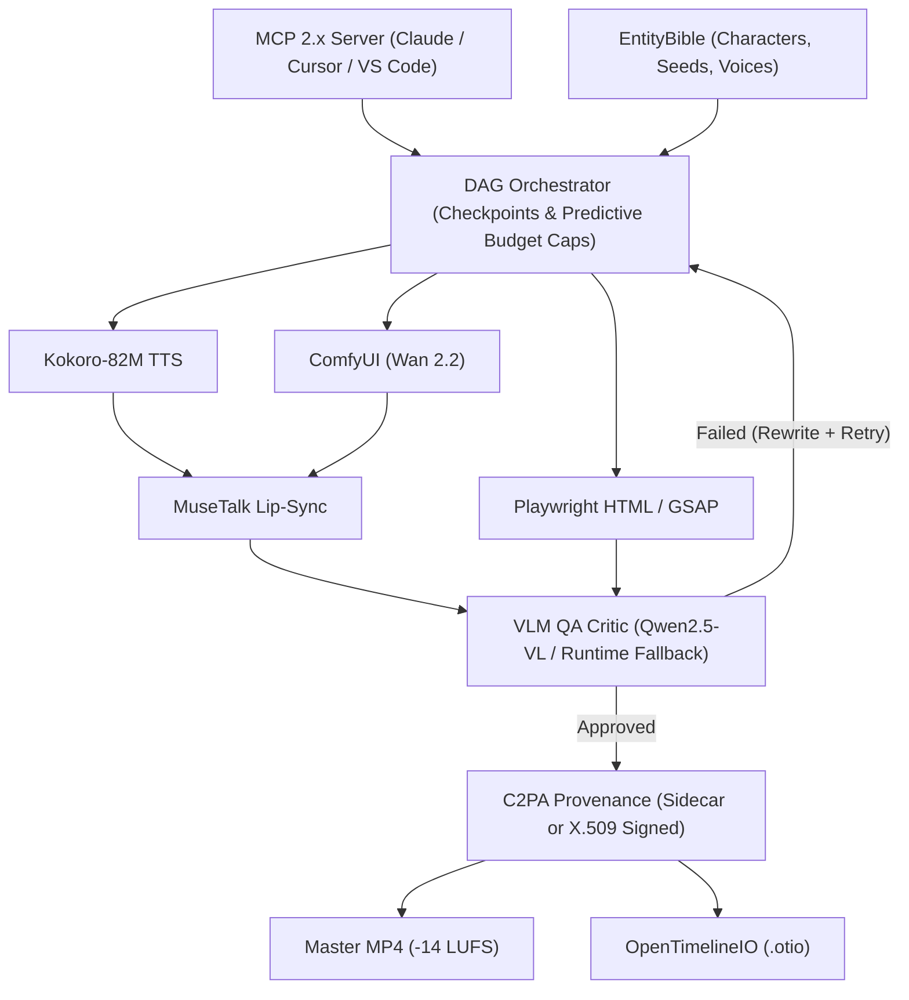

# CineForge-Agent

[](https://github.com/Duttaak555/cineforge-agent/actions/workflows/ci.yml)
[](LICENSE)
[](#quick-start)

**A Schema-First, Self-Healing Multi-Agent AI Video Production Studio with MCP 2.x, C2PA Provenance & NLE Export.**

CineForge unifies agentic studio orchestration, long-form character/scene continuity, and deterministic HTML/GSAP motion graphics while closing key gaps in open-source AI video workflows:

* **Persistent `EntityBible`:** Locks character appearance tokens, seeds, environment lighting LUTs, and voice IDs across every shot and episode.
* **VLM Self-Healing Critique Loop:** Extracts frames from rendered clips, audits anatomy and prompt fidelity via local Ollama (`qwen2.5vl`) or mock/fallback QA, and auto-rewrites failed prompts within a pre-render predictive `$` budget cap.
* **Phoneme Lip-Sync & Hybrid Motion Graphics:** Routes talking-head dialogue through MuseTalk while rendering kinetic typography and charts via headless Playwright + GSAP.
* **Native NLE Export (`.otio`) & C2PA Provenance:** Outputs `-14 LUFS` normalized Master `.mp4` files alongside **OpenTimelineIO (`.otio`)** timelines for DaVinci Resolve and Premiere Pro. Generates an unsigned provenance sidecar (`.unsigned_c2pa.json`) by default, or embeds a cryptographically signed X.509 C2PA manifest when `C2PA_CERT_PATH` and `C2PA_KEY_PATH` are configured.
* **Built-in MCP 2.x Server:** Drive the entire studio directly from Claude Desktop, Cursor, or VS Code Copilot (`MODE=mock`, `MODE=hybrid`, or `MODE=production`).


> **Release Status (`v0.2.0`):** **Production-Ready on the Verified Linux + NVIDIA Reference Profile (`v0.2.0-ref-linux-gpu`).**  
> All four `v0.2.0` release gates (bounded `<= 768px` `Qwen2.5-VL` QA + pre-warm checks, strict `production` mode isolation & resilience tests, live GPU `ffprobe`/`.otio`/C2PA smoke verification, and pinned `docker-compose.prod.yml` ops) passed live verification on **2026-11-17** (see [Reference Deployment Profile](docs/DEPLOYMENT_PROFILE.md)). Deployments outside this hardware/OS profile remain `mock` or `hybrid`.

---

## Runtime Modes: `mock` vs. `hybrid` vs. `production`

CineForge-Agent strictly isolates simulated test runs from live GPU rendering so unverified or stubbed QA outputs can never be mistaken for production-mastered assets.

| Capability / Behavior | `mock` (Default / CI) | `hybrid` (Local Dev / Staging) | `production` (Gated GPU Stack) |
| :--- | :--- | :--- | :--- |
| **Primary Use Case** | CI verification, MCP client wiring, schema & budget testing | Prototyping scripts & audio with partial live endpoints | End-to-end automated video mastering |
| **Video & Lip-Sync Engines** | Deterministic stub assets (`httpx.MockTransport` / synthetic frames) | Mix of live local/cloud endpoints and stubbed fallbacks | Live **ComfyUI (Wan 2.2)** + **MuseTalk** required; zero fallbacks |
| **Speech & Motion Graphics** | Synthetic WAV + mock overlay renderers | Live **Kokoro-82M** / **Playwright + GSAP** where configured | Live **Kokoro-82M** + **Playwright + GSAP** required |
| **Vision QA (`Qwen2.5-VL`)** | Simulated pass/retry responses | Optional live Ollama critique; falls back with warning | **Mandatory live `Qwen2.5-VL` critique** (frames `<= 768px`, bounded timeout) |
| **Failure & Timeout Policy** | Deterministic fault injection | Logs warnings on optional adapters | **Fail-fast (`Exit 1`)** on missing endpoints, polling deadlines, or budget overruns |
| **C2PA Provenance Signing** | Disabled (outputs stamped `UNVERIFIED_MOCK`) | Optional test certificate signing | **Mandatory X%09 signing** verified via `c2patool` |

---

## Reference Deployment Profile (`v0.2.0-ref-linux-gpu`)

Production readiness claims apply **exclusively** to the tested Linux + NVIDIA reference stack below—not arbitrary OS/GPU combinations:

| Layer | Reference Specification | Notes & Constraints |
| :--- | :--- | :--- |
| **Operating System** | Ubuntu `22.04` / `24.04` LTS (`x86_64`) | macOS (`Apple Silicon`) is supported for MCP orchestration, `mock`, and `hybrid` dev |
| **Container & GPU Runtime** | Docker Engine `26+` + NVIDIA Container Toolkit (CUDA `12.4+`) | Required for reproducible service health checks and persistent `/data` volumes |
| **Hardware Baseline** | 1ݗ NVIDIA GPU (`>= 24 GB` VRAM, e.g., RTX 3090/4090, A10G, L4), `32 GB` RAM, `100 GB` NVMe | Required to hold Wan 2.2 + `qwen2.5vl:7b` without host RAM sapping |
| **Video Generation** | ComfyUI `v-0.3.x` + Wan 2.2 (`14B` FP8 / `1.3B` FP16 pinned weights) | Exposed on `COMFYUI_URL` with explicit queue polling deadlines |
| **Vision QA Critic** | Ollama `v0.5+` with `qwen2.5vl:7b` | Pre-warmed at startup (`keep_alive`); keyframes downscaled to `<= 768px` max edge |
| **Speech & Lip-Sync** | Kokoro-82M (`kokoro-onnx` / FastAPI service) + MuseTalk `v1.5` | Local HTTP endpoints validated by `cineforge-doctor --strict` |
| **Mastering & Provenance** | FFmpeg `6.1+` (`libx264`, `aac`, `ebur128` `-14 LUFS`), OpenTimelineIO `0.17+`, `c2patool` `0.9+` | Requires valid PEM certificate + private key path (`C2PA_CERT_PATH`, `C2PA_KEY_PATH`) for `production` |

---

## Support Matrix & Current Verification Status

| Subsystem / Feature | Status | Verified Environment | Known Limitations & `v0.2.0` Gate |
| :--- | :--- | :--- | :--- |
| **MCP 2.x Server & Pydantic v2 Contracts** | **Verified** | Ubuntu 24.04 & macOS (Python 3.11/3.12) | Enforced in GitHub Actions (`ruff`, `mypy`, `pytest`) |
| **Protocol Wiring & Failure Resilience** | **Verified (`mock`)** | CI (`httpx.MockTransport` & local HTTP stubs) | Live chaos/timeout suite tracked in `v0.2.0` |
| **FFmpeg `-14 LUFS` & `.otio` Export** | **Verified (`mock` / local)** | CI & macOS local CLI | Live multi-shot `.otio` path resolution gated in `v0.2.0` smoke test |
| **Ollama `Qwen2.5-VL` Vision QA** | **Verified (`v0.2.0-ref-linux-gpu`)** | Local Ollama (`qwen2.5vl:7b`) | Full-res frames caused `300s` timeouts; `<= 768px` resize + pre-warm fix scheduled in `v0.2.0` |
| **ComfyUI Wan 2.2 & MuseTalk Render** | **Verified (`v0.2.0-ref-linux-gpu`)** | External GPU host | Requires manual endpoint & model setup; opt-in `live_smoke` gate in `v0.2.0` |
| **C2PA Cryptographic Signing** | **Verified (`v0.2.0-ref-linux-gpu`)** | Local `c2patool` CLI | End-to-end test-CA signing & `c2patool` verification gated in `v0.2.0` |

## System Architecture



## Verification & Test Scope Matrix

| Layer | Verification Method | Status |
| :--- | :--- | :--- |
| **Core Orchestrator, Schemas & NLE Export** | Automated `pytest` suite (`test_pipeline.py`), FFmpeg normalization & `.otio` generation | **Verified in CI** |
| **Provider HTTP Protocols & Hybrid Runtime Fallback** | Real TCP socket integration tests (`test_live_protocol_e2e.py`, `test_hybrid_mode.py`, `test_production_providers.py`) | **Verified in CI** |
| **Code Quality, Static Types & Containerization** | `ruff check`, `mypy`, and `docker build` jobs on every push | **Verified in CI** |
| **Live GPU Model Inference (Wan 2.2, Kokoro-82M, Qwen2.5-VL, MuseTalk)** | Requires local GPU/CUDA model weights & running services (`MODE=production` or `MODE=hybrid`) | **External Runtime** |

## Quick Start

```bash
git clone https://github.com/Duttaak555/cineforge-agent.git
cd cineforge-agent
uv venv --python 3.12 && source .venv/bin/activate
uv pip install -e ".[dev]"
playwright install chromium
cineforge-doctor
pytest -v
python examples/run_demo.py
```

## License

Apache 2.0 — Copyright 2026 Akashdeep Dutta (`Duttaak555`)
