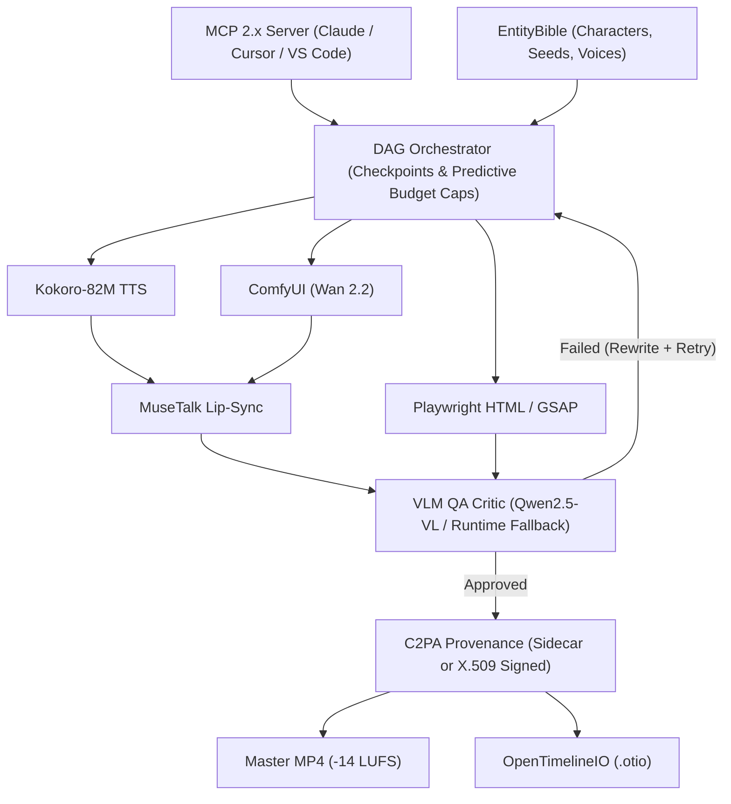

# CineForge-Agent

[](https://github.com/Duttaak555/cineforge-agent/actions/workflows/ci.yml)
[](LICENSE)
[](#quick-start)

**A Schema-First, Self-Healing Multi-Agent AI Video Production Studio with MCP 2.x, C2PA Provenance & NLE Export.**

CineForge unifies agentic studio orchestration, long-form character/scene continuity, and deterministic HTML/GSAP motion graphics while closing key gaps in open-source AI video workflows:

* **Persistent `EntityBible`:** Locks character appearance tokens, seeds, environment lighting LUTs, and voice IDs across every shot and episode.
* **VLM Self-Healing Critique Loop:** Extracts frames from rendered clips, audits anatomy and prompt fidelity via local Ollama (`qwen2.5vl`) or mock/fallback QA, and auto-rewrites failed prompts within a pre-render predictive `$` budget cap.
* **Phoneme Lip-Sync & Hybrid Motion Graphics:** Routes talking-head dialogue through MuseTalk while rendering kinetic typography and charts via headless Playwright + GSAP.
* **Native NLE Export (`.otio`) & C2PA Provenance:** Outputs `-14 LUFS` normalized Master `.mp4` files alongside **OpenTimelineIO (`.otio`)** timelines for DaVinci Resolve and Premiere Pro. Generates an unsigned provenance sidecar (`.unsigned_c2pa.json`) by default, or embeds a cryptographically signed X.509 C2PA manifest when `C2PA_CERT_PATH` and `C2PA_KEY_PATH` are configured.
* **Built-in MCP 2.x Server:** Drive the entire studio directly from Claude Desktop, Cursor, or VS Code Copilot (`MODE=mock`, `MODE=hybrid`, or `MODE=production`).

## System Architecture



## Verification & Test Scope Matrix

| Layer | Verification Method | Status |
| :--- | :--- | :--- |
| **Core Orchestrator, Schemas & NLE Export** | Automated `pytest` suite (`test_pipeline.py`), FFmpeg normalization & `.otio` generation | **Verified in CI** |
| **Provider HTTP Protocols & Hybrid Runtime Fallback** | Real TCP socket integration tests (`test_live_protocol_e2e.py`, `test_hybrid_mode.py`, `test_production_providers.py`) | **Verified in CI** |
| **Code Quality, Static Types & Containerization** | `ruff check`, `mypy`, and `docker build` jobs on every push | **Verified in CI** |
| **Live GPU Model Inference (Wan 2.2, Kokoro-82M, Qwen2.5-VL, MuseTalk)** | Requires local GPU/CUDA model weights & running services (`MODE=production` or `MODE=hybrid`) | **External Runtime** |

## Quick Start

```bash
git clone https://github.com/Duttaak555/cineforge-agent.git
cd cineforge-agent
uv venv --python 3.12 && source .venv/bin/activate
uv pip install -e ".[dev]"
playwright install chromium
cineforge-doctor
pytest -v
python examples/run_demo.py
```

## License

Apache 2.0 — Copyright 2026 Akashdeep Dutta (`Duttaak555`)
